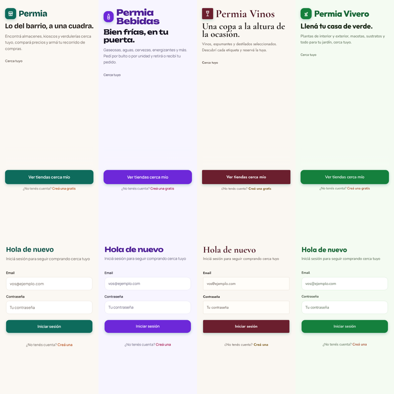

# Levantar Permia para un cliente nuevo (un VPS por cliente)

Permia se vende como **una instalación por cliente**. Todas salen del mismo repo y
de la misma imagen Docker; lo que cambia entre clientes son las **variables de
entorno**. El rubro (`PERMIA_RUBRO`) define todo el estilo del frontend
(`specs/sdd/21-temas.md`).

| Rubro | Estilo |
| --- | --- |
| `bebidas` | moderno y joven: violeta eléctrico + fucsia, Unbounded, bordes muy redondos |
| `vinos` | sobrio y elegante: bordó + oro viejo sobre marfil, Cormorant Garamond, esquinas rectas |
| `vivero` | vibrante y verde: verde hoja + terracota, Outfit |
| `almacen` | el de Almacenia: verde petróleo + naranja, Bricolage Grotesque |



## Checklist por cliente

1. **VPS**: Ubuntu LTS, 2 vCPU / 4 GB RAM alcanza para empezar. Anotá la IP.
2. **Coolify** en el VPS (`curl -fsSL https://cdn.coollabs.io/coolify/install.sh | bash`),
   o un Coolify central que administre el VPS del cliente como servidor remoto.
3. **Base de datos**: Postgres con la imagen `postgis/postgis:16-3.4`
   ([`deploy-coolify.md` §1](deploy-coolify.md)).
4. **Fotos**: MinIO o un S3 con un bucket por cliente (§2.5).
5. **App**: recurso desde este repo (rama `main`), Dockerfile, puerto 3000 (§3).
6. **Variables** (§4). Las de Permia:
   ```env
   PERMIA_RUBRO=bebidas
   PERMIA_NOMBRE=Distribuidora Don Pepe
   # opcionales:
   PERMIA_ESLOGAN=Bien frías, en tu puerta.
   PERMIA_DESCRIPCION=Gaseosas, aguas y cervezas por bulto o por unidad.
   ```
   `AUTH_SECRET`, credenciales de DB y de S3: **siempre nuevas para cada cliente**.
7. **Dominio** del cliente apuntando a la IP del VPS (registro A), con HTTPS (§6).
8. **Admin**: promové la cuenta del cliente a admin (§9).
9. **Verificación** (§8): la portada muestra la marca, el ícono y los colores del
   rubro. Si en el log aparece `[tema] PERMIA_RUBRO="…" no es un rubro conocido`,
   está mal escrito el rubro (la app sigue funcionando con el tema `almacen`).

## Cambiar el rubro o el nombre de un cliente

Se leen en runtime: cambiá la variable en Coolify y **reiniciá** el contenedor. No
hace falta rebuild.

## Agregar un rubro nuevo

1. Agregarlo a la tabla de `specs/sdd/21-temas.md`.
2. Agregar el tema en `src/lib/tema/tema.ts` (y sus fuentes en `src/app/fuentes.ts`
   si usa otras). `npm test` verifica el contraste mínimo de la paleta.
3. Si necesita otro ícono de marca, sumarlo en `src/components/tema/IconoMarca.tsx`.
